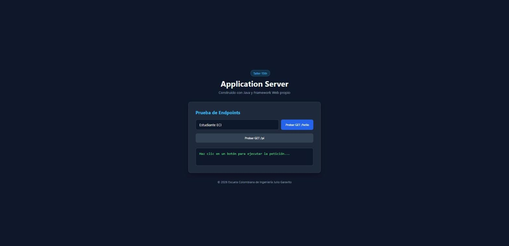
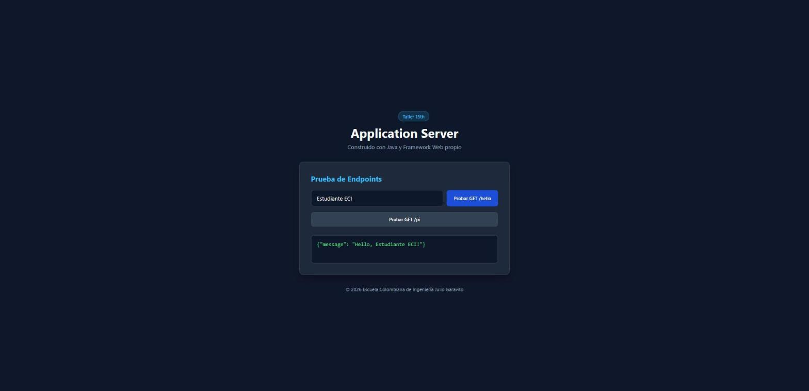
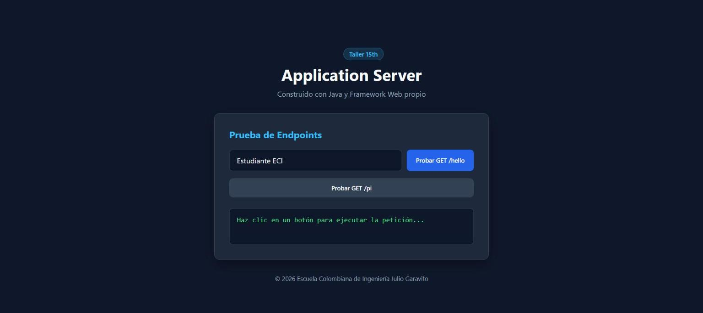
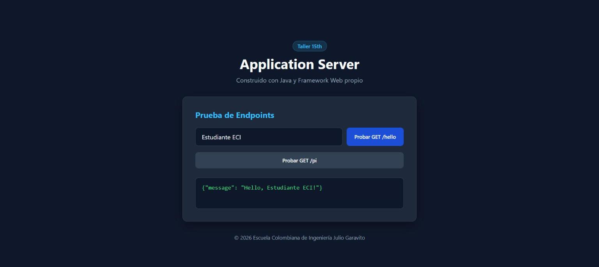
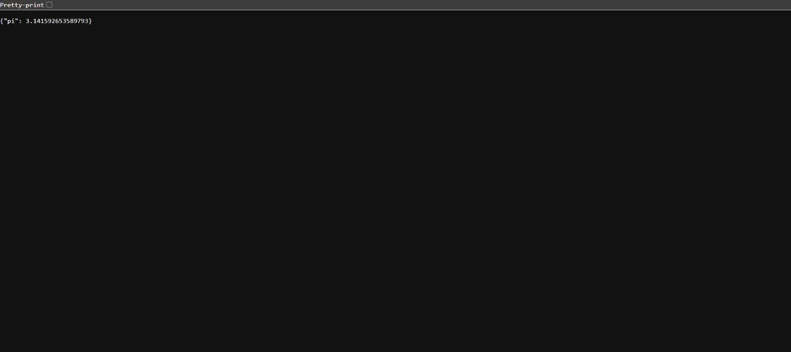
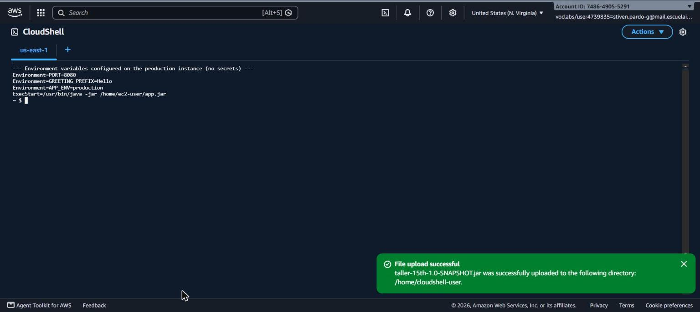
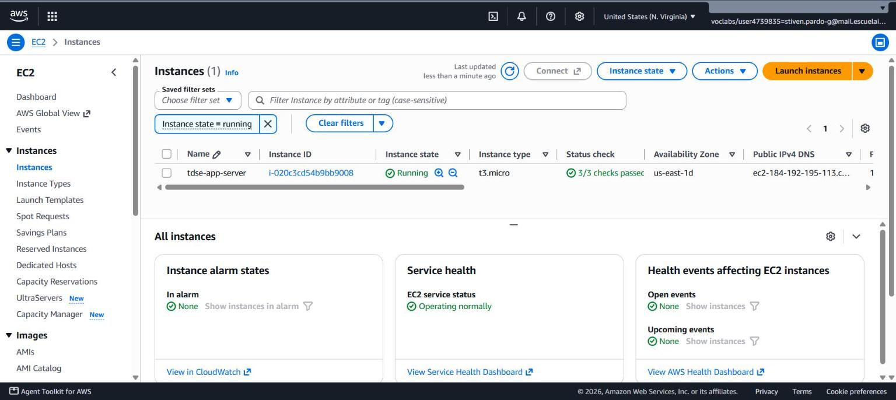
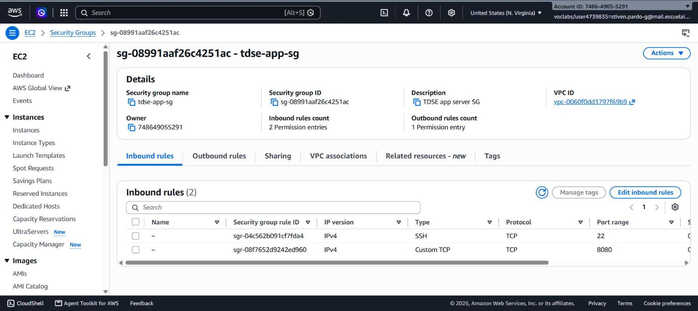

# Maintainable Application Server

**Author:** Stiven Esneider Pardo Gutierrez
**Course:** TDSE

A small Java web framework that lets developers register HTTP GET services through lambda functions, serve static resources, and run as a maintainable, sequential application server — evolved from a hard-coded HTTP server into a reusable framework.

---

## 1. Description

This project implements a lightweight application server on top of raw Java sockets (`java.net.ServerSocket`). Instead of hard-coding routes inside the connection loop, application developers register routes as lambda functions:

```java
WebFramework.staticfiles("webroot");

WebFramework.get("/hello", (req, resp) -> {
    String name = req.getValue("name");
    return "{\"message\": \"" + greetingPrefix + ", " + (name == null || name.isBlank() ? "World" : name) + "!\"}";
});

WebFramework.get("/pi", (req, resp) -> "{\"pi\": " + Math.PI + "}");

WebFramework.start(port);
```

The HTTP connection loop never needs to change when a new route is added — it only consults the `Router`.

---

## 2. Architecture

```
Application            registers routes and static file location
    │
    ▼
WebFramework            static facade: staticfiles(), get(), start(), stop()
    │
    ▼
Router                  maps (method, path) -> GetLambda handler
    │
    ▼
HttpServer               accepts connections sequentially, parses requests,
    │                    sends responses, dispatches to Router or StaticFileService
    ▼
Request / Response        represent parsed HTTP data (query params, status, headers)
    │
    ▼
StaticFileService         serves files from the classpath when no route matches
```

### Responsibilities of the main components

| Component | Responsibility |
|---|---|
| `Application` | Registers routes and static resource location, and reads deployment configuration from environment variables. The only class an application developer needs to touch. |
| `WebFramework` | Static facade exposing `staticfiles()`, `get()`, `post()`, `start()`, `stop()`. Hides socket/thread details from the developer. |
| `Router` | Stores registered routes and resolves an incoming `(method, path)` pair to a `GetLambda` handler. |
| `HttpServer` | Owns the `ServerSocket`, accepts one connection at a time, parses the raw HTTP request, and writes the raw HTTP response. Contains no application logic. |
| `Request` | Read-only view of the incoming request: method, path, query parameters via `getValue(key)`, and body. |
| `Response` | Lets a handler set the status code and headers (e.g. `Content-Type`) before the body is written. |
| `StaticFileService` | Resolves a request path to a classpath resource under the configured static root and infers its content type. |
| `GetLambda` | Functional interface `(Request, Response) -> String` — the contract every route handler implements. |

### Request flow

```
Incoming connection
      ↓
Parse HTTP method, path, and query string
      ↓
Router.getRoute(method, path)
      ↓
 found? → run GetLambda handler → write response
      ↓ not found
StaticFileService.getFileContent(path)
      ↓
 found? → write file bytes with inferred Content-Type
      ↓ not found
Write 404 Not Found
```

### Architecture metaphor — an office building

| Building metaphor | Framework component |
|---|---|
| Entrance and receptionist | `HttpServer` — accepts every visitor (connection) one at a time, reads what they're asking for |
| Directory in the lobby | `Router` — looks up which office handles the visitor's request |
| Individual offices | `GetLambda` handlers registered via `get()` — each implements one specific service |
| Document archive | `StaticFileService` — hands out pre-existing documents (HTML, CSS, JS, images) when no office needs to get involved |
| Building configuration | Environment variables (`PORT`, `GREETING_PREFIX`, `APP_ENV`, `STATIC_FILES_PATH`) — deployment-specific settings, not printed on the walls (hard-coded) |
| Closing procedure | Graceful shutdown (`/shutdown`, development only) — the building finishes serving the visitor currently at the desk, locks the front door, and only then the receptionist goes home |

This works because each part has **one job**: the receptionist doesn't know how to do office work, the directory doesn't answer questions itself, and the archive doesn't care what happens in the offices. Adding a new office (route) never requires retraining the receptionist (touching `HttpServer`).

---

## 3. Why this is maintainable

| Principle | Application in this project |
|---|---|
| Separation of concerns | HTTP parsing/socket handling (`HttpServer`) is separate from application behavior (`Application`'s lambdas). |
| Modularity | Routing, request/response modeling, and static files are each their own class. |
| Low coupling | Adding a route means calling `get(...)` in `Application`; `HttpServer` is never touched. |
| High cohesion | Each class has a single, focused responsibility (see table above). |
| Abstraction | Developers call `get()` / `staticfiles()` without ever touching a `Socket`. |
| Externalized configuration | Port, greeting prefix, environment, and static-files path all come from environment variables, not source code. |
| Extensibility | New services are added by registering more lambdas — no new server code. |
| Testability | `Router`, `Request` parsing, and individual handlers can be tested in isolation from socket I/O. |
| Operational maintainability | The same source builds and runs identically locally and in the cloud. |

---

## 4. Build and run locally

Requirements: JDK 17+ and Maven.

```bash
mvn clean package
java -jar target/taller-15th-1.0-SNAPSHOT.jar
```

(`mvn exec:java` also works for development.) The server starts on port `8080` by default and binds to all interfaces (`0.0.0.0`), so it is reachable from outside the host, not just `localhost`.

Stop it with `Ctrl+C`, or — in development mode only — by requesting `GET /shutdown` (see [Graceful shutdown](#7-graceful-shutdown)).

---

## 5. Environment variables

| Variable | Purpose | Local default |
|---|---|---|
| `PORT` | HTTP server port | `8080` |
| `GREETING_PREFIX` | Prefix used by the `/hello` route's message | `Hello` |
| `APP_ENV` | Execution environment (`development` / `production`); gates the `/shutdown` route | `development` |
| `STATIC_FILES_PATH` | Classpath folder used as the static resources root | `webroot` |

No credentials, tokens, or secrets are used or stored anywhere in this project.

---

## 6. Example URLs

Local (`http://localhost:8080`) and public cloud deployment (`http://184.192.195.113:8080`) both expose the same routes:

| Path | Expected result |
|---|---|
| `/` | Static `index.html` |
| `/index.html` | Static HTML page |
| `/app.js` | Static JavaScript |
| `/styles.css` | Static CSS |
| `/images/logo.png` | Static binary image (`image/png`) |
| `/hello?name=Pedro` | Dynamic JSON response from a lambda: `{"message": "Hello, Pedro!"}` |
| `/pi` | Dynamic JSON response from a lambda: `{"pi": 3.141592653589793}` |
| `/api/status` | Dynamic JSON status response, includes current `APP_ENV` |
| `/shutdown` | Development only: stops the server gracefully after responding (`404` in production — see [Cloud deployment](#8-cloud-deployment)) |
| `/unknown` | `404 Not Found` |

Local evidence:

| Static page (`/`) | Dynamic `fetch()` call (`/hello`) |
|---|---|
|  |  |

| Binary static resource (`/images/logo.png`) | Unknown route (`/unknown` → 404) |
|---|---|
|  |  |

---

## 7. Graceful shutdown

`WebFramework.stop()` only flips a `running` flag and closes the `ServerSocket`; it never interrupts the client connection currently being served. The `/shutdown` route is registered **only** when `APP_ENV=development`:

```java
if ("development".equals(appEnv)) {
    WebFramework.get("/shutdown", (req, resp) -> {
        WebFramework.stop();
        return "{\"message\": \"Server will stop after this response.\"}";
    });
}
```

Order of events: the handler calls `stop()` → returns its message → the framework writes that response to the client → the client connection is closed → the main `while (running)` loop exits without accepting new connections → the `ServerSocket` closes → `"Server stopped gracefully."` is printed.

**Evidence — development (`APP_ENV=development`):**

```
$ PORT=8080 GREETING_PREFIX=Hola APP_ENV=development java -jar target/taller-15th-1.0-SNAPSHOT.jar
==================================================
🚀 Custom Sequential HttpServer running on port: 8080
==================================================

$ curl http://localhost:8080/hello?name=Pedro
{"message": "Hola, Pedro!"}

$ curl http://localhost:8080/api/status
{"status": "UP", "framework": "Sequential Custom HttpServer", "env": "development"}

$ curl -i http://localhost:8080/shutdown
HTTP/1.1 200 OK
Content-Type: application/json; charset=utf-8

{"message": "Server will stop after this response."}

# server process console:
Server stopped gracefully.

$ curl http://localhost:8080/pi
curl: (7) Failed to connect to localhost port 8080: Connection refused
```

**Evidence — production (`APP_ENV=production`), `/shutdown` not available:**

```
$ PORT=8080 APP_ENV=production java -jar target/taller-15th-1.0-SNAPSHOT.jar

$ curl -i http://localhost:8080/shutdown
HTTP/1.1 404 Not Found
Content-Type: text/plain; charset=utf-8

404 Not Found

$ curl http://localhost:8080/hello?name=World
{"message": "Hello, World!"}
```

---

## 8. Cloud deployment

**Platform:** AWS (EC2, AWS Academy Learner Lab), region `us-east-1`.

**Public URL:** http://184.192.195.113:8080/

> AWS Academy Learner Lab sessions are time-boxed and the instance stops when the lab session ends, so this URL is only guaranteed to respond while the lab is active.

### How it was deployed

1. Built a runnable jar locally: `mvn clean package` → `target/taller-15th-1.0-SNAPSHOT.jar`.
2. Created a security group (`tdse-app-sg`) allowing inbound TCP `22` (SSH, for deployment) and `8080` (the app) from `0.0.0.0/0`.
3. Launched a `t3.micro` EC2 instance (Amazon Linux 2023, default VPC/subnet) with a dedicated key pair.
4. Copied the jar to the instance (`scp`) and installed `java-17-amazon-corretto-headless`.
5. Registered it as a systemd service (`tdse-app.service`) so it survives reboots/crashes, with the deployment configuration set as environment variables on the service itself — **not** in the source code:

   ```ini
   [Service]
   Environment=PORT=8080
   Environment=GREETING_PREFIX=Hello
   Environment=APP_ENV=production
   ExecStart=/usr/bin/java -jar /home/ec2-user/app.jar
   ```

6. Verified the app from outside the instance (`curl` from CloudShell, then a real browser) and confirmed `/shutdown` is not reachable with `APP_ENV=production`.

### Reproducing this deployment

```bash
# 1. Build
mvn clean package

# 2. On any Linux host with Java 17+:
scp target/taller-15th-1.0-SNAPSHOT.jar user@host:/path/app.jar
ssh user@host
sudo PORT=8080 APP_ENV=production GREETING_PREFIX=Hello \
     java -jar /path/app.jar
# (or wrap it in a systemd unit as shown above for persistence)
```

### Cloud evidence

**Deployed page and REST endpoints (public IP):**

| Static page | `fetch()` call to `/hello` |
|---|---|
|  |  |

| `GET /pi` | `GET /shutdown` in production → `404` |
|---|---|
|  |  |

**Configured environment variables on the instance (no secrets):**



**AWS console — running EC2 instance:**



**AWS console — security group (ports 22 and 8080 only):**



---

## 9. Tests performed

Manual verification against the local server (`java -jar target/taller-15th-1.0-SNAPSHOT.jar`):

- `GET /hello?name=Pedro` → `200 OK`, `{"message": "Hello, Pedro!"}` (and respects `GREETING_PREFIX`)
- `GET /pi` → `200 OK`, `{"pi": 3.141592653589793}`
- `GET /api/status` → `200 OK`, reflects the current `APP_ENV`
- `GET /` and `GET /app.js` → `200 OK` with correct `Content-Type` (`text/html`, `application/javascript`)
- `GET /images/logo.png` → `200 OK`, `image/png`, binary content served and rendered correctly in-browser
- `GET /unknown` → `404 Not Found`, `text/plain`
- Malformed request line sent over a raw socket → `400 Bad Request`, server keeps running and accepts the next connection (sequential loop, no crash)
- `GET /shutdown` in development → `200 OK`, server stops gracefully, subsequent requests are refused
- `GET /shutdown` in production → `404 Not Found`, route is never registered

Same checks repeated against the public AWS deployment (`http://184.192.195.113:8080`, `APP_ENV=production`):

- `GET /hello?name=Pedro` → `200 OK`, `{"message": "Hello, Pedro!"}`
- `GET /pi` → `200 OK`, `{"pi": 3.141592653589793}`
- `GET /images/logo.png` → `200 OK`
- `GET /shutdown` → `404 Not Found` (confirmed not reachable in production)
